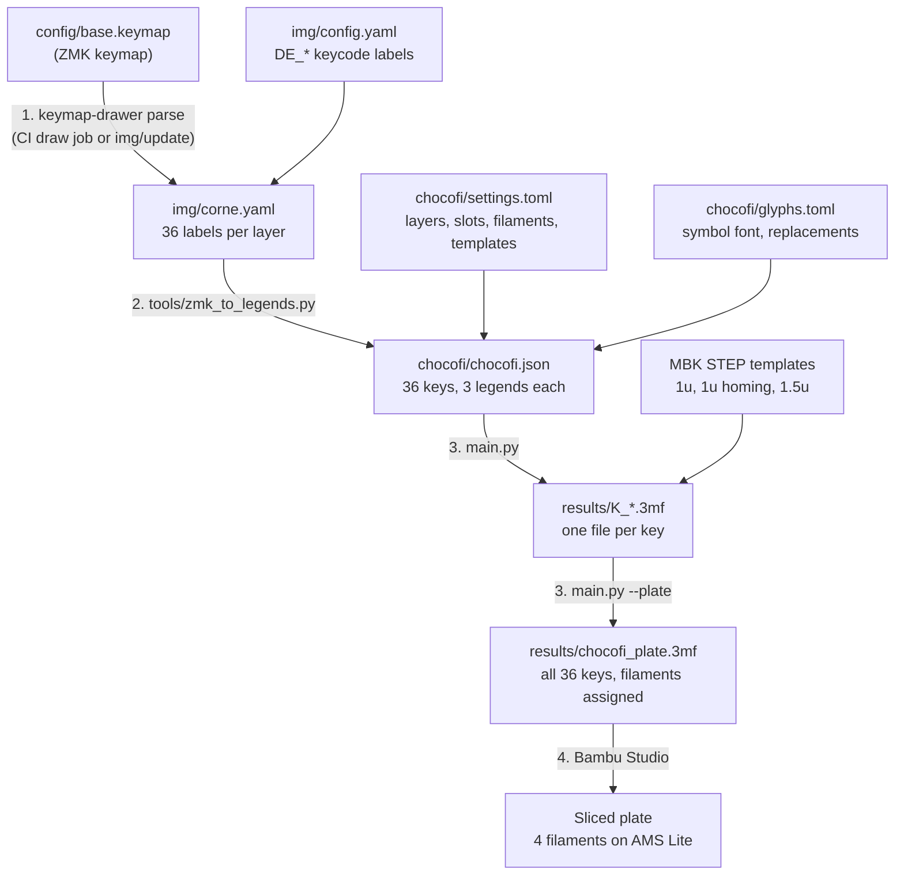
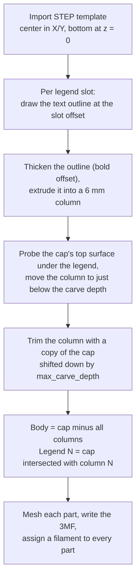

# Workflow: from ZMK keymap to printable keycaps

This describes the manual steps that turn the Chocofi ZMK keymap into the
multi-color keycap geometry, and what each step reads and writes.

Two repositories are involved:

| Repository | Path | Role |
|---|---|---|
| ZMK config | `C:\Development\bbens\personal\zmk-chocofi` | Source of the legends |
| Keycap generator (this repo) | `C:\Development\bbens\personal\keycap-legends` | Builds the geometry |

The keycap shapes come from a third folder that is only read:
`C:\Development\bbens\personal\MBK Choc Low Profile Keycaps\files`.

## Overview



## Step 1: Keymap to label file (ZMK repo)

**Input:** `config/base.keymap`, `img/config.yaml`
**Output:** `img/corne.yaml`

keymap-drawer parses the keymap and writes one label per key and layer. The
German keycodes (`DE_Z`, `DE_O_UMLAUT`, `DE_AT`, ...) are turned into the
characters they type (`Z`, `Ö`, `@`) by the table in `img/config.yaml`.

This normally happens by itself: every push to the ZMK repo runs the `draw` job
in `.github/workflows/build.yml`, which commits the updated `img/corne.yaml`.

Manual steps:

1. Edit `config/base.keymap`.
2. If you added a keycode that has no label yet, add it to `zmk_keycode_map` in
   `img/config.yaml`. Otherwise the raw keycode name ends up on the keycap.
3. Commit and push.
4. Wait for the `draw` job, then `git pull` to get the new `img/corne.yaml`.

To do it locally instead of through CI:

```bash
pip install "keymap-drawer==0.21.0" "tree-sitter>=0.24,<0.25" "tree-sitter-devicetree<0.15"
sh img/update
```

## Step 2: Label file to keycap spec (this repo)

**Input:** `img/corne.yaml` (ZMK repo), `chocofi/settings.toml`, `chocofi/glyphs.toml`
**Output:** `chocofi/chocofi.json`

```bash
uv run tools/zmk_to_legends.py chocofi/settings.toml
```

For each of the 36 key positions the script:

1. Takes the tap label from each layer listed in `[zmk] layers`
   (currently `Base`, `Num`, `Sym`). Held layer keys, transparent keys and empty
   keys give no legend. Hold labels (home-row modifiers) are ignored.
2. Maps the layers to legend slots in order: first layer = `primary`,
   second = `secondary`, third = `tertiary`.
3. Applies `chocofi/glyphs.toml`: replaces labels listed under `[replace]`,
   switches to `symbol_font` for characters listed in `symbols`, and scales
   labels listed under `[scale]`.
4. Picks the keycap template for the position from `[zmk.groups]`
   (positions 13 and 16 = homing, 32 and 33 = 1.5u, everything else = 1u).
5. Names the key `P<position>_<Base label>`, for example `P02_E`.

The result is the generator's normal config format, with the `[settings]` and
`[step_files]` tables copied from `chocofi/settings.toml` and one legend entry
per key.

What to edit when:

| To change | Edit |
|---|---|
| Which layers are printed | `[zmk] layers` in `chocofi/settings.toml` |
| Legend size and position per slot | `*_font_size`, `*_x_offset`, `*_y_offset` in `[settings]` |
| Legend depth | `max_carve_depth` in `[settings]` |
| Filament slot per part | `body_filament`, `legend_1_filament` .. `legend_3_filament` |
| Which template a key uses | `[zmk.groups]` and `[step_files.*]` |
| How a label is printed, or leave it blank | `[replace]` in `chocofi/glyphs.toml` |
| Font for special symbols | `symbol_font` and `symbols` in `chocofi/glyphs.toml` |

`chocofi/chocofi.json` is generated and not committed. Don't edit it by hand;
rerun the script.

## Step 3: Keycap spec to geometry (this repo)

**Input:** `chocofi/chocofi.json`, the MBK STEP templates
**Output:** `results/K_<key>_..._<template>.3mf` per key, and the combined plate

```bash
# All keys plus the combined plate (about three minutes)
uv run main.py --config chocofi/chocofi.json --plate results/chocofi_plate.3mf

# Only some keys, for a test print
uv run main.py --config chocofi/chocofi.json --only P02_E P13_F
```

What `main.py` does for each key:



1. **Template.** The STEP file for the key's group is imported and moved so its
   center is at x = y = 0 and its lowest point at z = 0. The stem is part of
   the template and is not changed.
2. **Text outline.** Each non-empty slot is drawn as a 2D outline at its
   offset from the cap center, aligned on the font baseline. The outline is
   thickened by `bold_offset` (Base) or `small_bold_offset` (Num, Sym). Glyphs
   whose outline is invalid are redrawn with a fallback; the log shows
   `drawn via ...` for those.
3. **Column.** The outline is extruded upwards into a 6 mm tall solid.
4. **Height.** Vertical probe lines find the lowest point of the cap's top
   surface under the legend. The column is moved so its bottom sits 0.2 mm
   below the deepest point the carve can reach.
5. **Depth limit.** A copy of the cap shifted down by `max_carve_depth` is
   subtracted from the column. What is left of the column inside the cap is a
   layer of constant depth that follows the curved top.
6. **Cut and extract.** The columns are cut out of the cap one after another;
   the result is the part `cap body`. Each column intersected with the
   original cap gives the legend parts `legend_1` (Base), `legend_2` (Num) and
   `legend_3` (Sym). The legends fill the cut exactly and are flush with the
   top surface.
7. **Export.** Each part is meshed and written to one 3MF per key. The file is
   then rewritten as a single object with several parts, each with its
   filament slot from the settings.
8. **Plate.** With `--plate`, all per-key files are merged into one 3MF. Every
   key keeps its parts and filaments and gets a position on a grid centered on
   a 256 x 256 mm bed, in keymap order.

Check the log at the end of the run:

| Message | Meaning |
|---|---|
| `Done: 36 keycaps written, 0 failed` | Everything was generated |
| `drawn via union dilation` / `repaired outline` | A glyph needed the fallback; harmless |
| `WARNING: ... legends overlap` | Two slots collide; reduce a size or move an offset |
| `WARNING: ... reaches the cap edge` | A legend is too close to the rim |
| `WARNING: dropped N island solids` | A legend cut a piece loose; use a shallower `max_carve_depth` |
| `ERROR: ...` and `Failed keys:` | That key was not written and is missing from the plate |

## Step 4: Geometry to print (Bambu Studio)

**Input:** `results/chocofi_plate.3mf`
**Output:** sliced plate

1. Open `results/chocofi_plate.3mf` in Bambu Studio.
2. Check that there are 36 objects and that each has the parts `cap body`,
   `legend_1`, `legend_2`, `legend_3` on filaments 1 to 4.
3. Load the four filaments in the AMS Lite in the same order:
   1 = body, 2 = Base legend, 3 = Num legend, 4 = Sym legend.
4. Keep the caps upright (stem down). The colors then only change in the top
   0.6 mm. The hollow underside needs supports.
5. Slice and check the preview of the top layers before printing.

Print a single cap first (`--only P02_E`) and test it on a switch: the MBK
templates were made for rendering, so the stem fit is not guaranteed.

## Short version

```bash
# ZMK repo: after editing and pushing the keymap, wait for CI, then
git pull

# Keycap repo
uv run tools/zmk_to_legends.py chocofi/settings.toml
uv run main.py --config chocofi/chocofi.json --plate results/chocofi_plate.3mf
# open results/chocofi_plate.3mf in Bambu Studio
```
